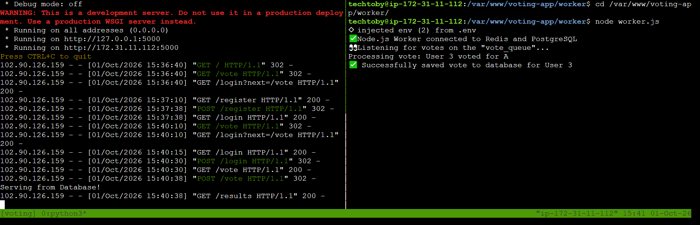
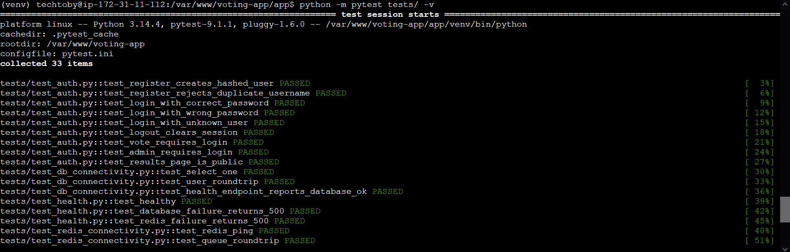
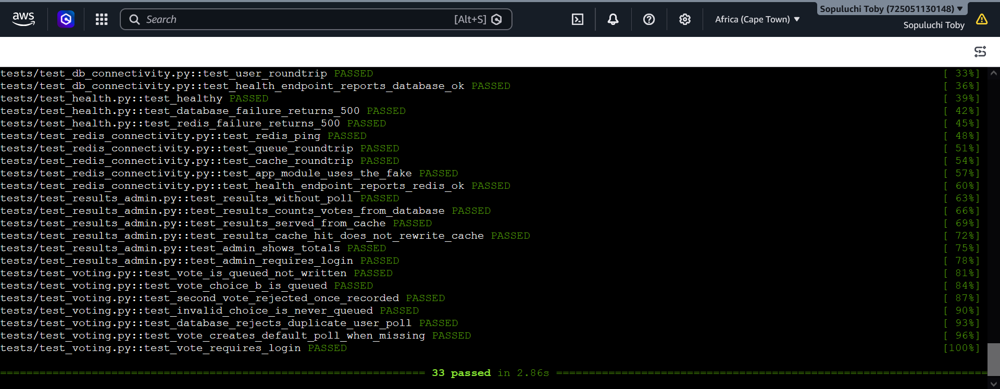
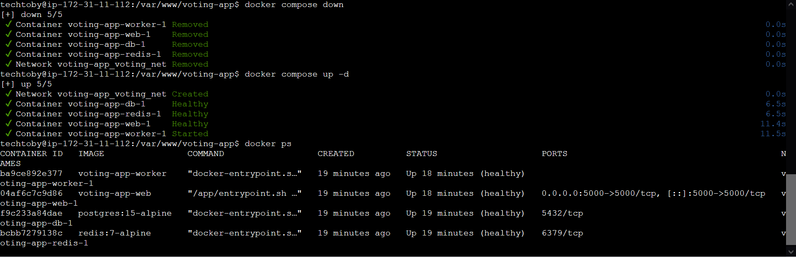
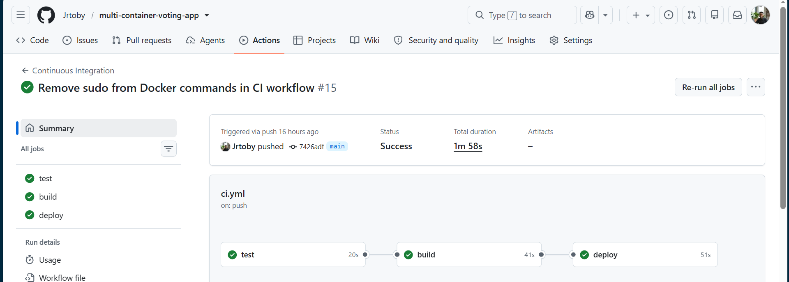
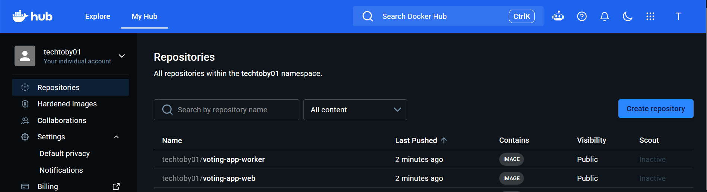
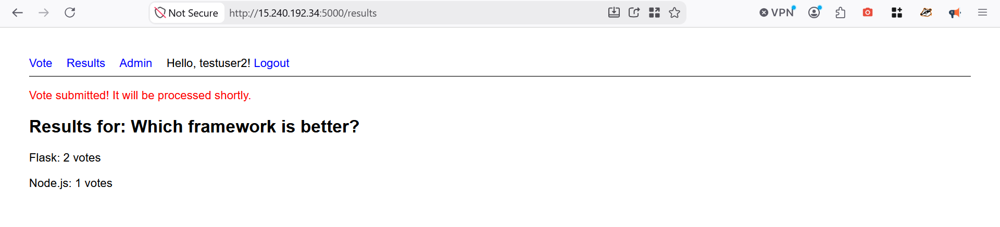

## Multi-Container Voting App


A Dockerised, multi-service voting application built with Flask, Node.js, PostgreSQL and Redis, featuring a fully automated CI/CD pipeline.

## 🎯 Project Objectives
*   Build a secure, scalable web-based voting platform where users can register, authenticate, and cast a single vote.
*   Implement asynchronous processing to decouple vote submission from database writes, ensuring the application remains responsive under heavy load.
*   Implement caching to speed up results retrieval and reduce database read load.
*   Health-check endpoint for each service, application monitoring and logging.
*   Establish a fully automated CI/CD pipeline from GitHub to AWS EC2 to eliminate manual deployment errors.

## 🏗️ Architecture
 

*   **Flask (`web`)**: Handles HTTP routing, UI rendering, authentication, and vote submission. It acts as the API layer.
*   **Node.js (`worker`)**: Background worker that continuously drains the Redis queue and writes votes to PostgreSQL asynchronously.
*   **PostgreSQL (`db`)**: Persistent relational storage for users, polls, and votes.
*   **Redis (`redis`)**: Acts as both a message broker (vote queue) and a caching layer (results cache) to optimize performance.

## 🛠️ Tech Stack
*   **Frontend**: HTML5 Templates
*   **Backend**: Python (Flask), Node.js
*   **Database**: PostgreSQL 15, Redis 7
*   **DevOps**: Docker, Docker Compose, GitHub Actions, AWS EC2

## 🚀 Local Development (Without Docker)
1. Clone the repository and navigate to the `app` directory.
2. Install dependencies: `cd app && pip install -r requirements.txt`
3. Set up environment variables: Copy `.env.example` to `.env` and fill in the values.
4. Run tests: `python -m pytest tests/ -v`
5. Start the app locally: `flask run --host=0.0.0.0`

## 🧠 Microservices in Action (Asynchronous Processing)
This screenshot demonstrates the asynchronous architecture working in real-time. The left pane shows the Flask web server receiving HTTP requests (login, register, vote). The right pane shows the Node.js worker running as a separate service. When a user votes, Flask pushes the vote to the Redis queue (`vote_queue`) and immediately returns a success page. The Node.js worker then pulls the vote from the queue and safely writes it to PostgreSQL in the background, preventing database lockups under high traffic.


### Running the Automated Tests
The project includes a comprehensive test suite built with `pytest`. The tests are designed to be completely service-free (no Docker, PostgreSQL, or Redis required) by using SQLite and `fakeredis`.

### Prerequisites
Make sure you are in the `app/` directory and your virtual environment is activated:
```bash
cd /var/www/voting-app
git pull origin main
cd app
source venv/bin/activate
pip install -r requirements.txt

Execute the following command to run all tests:

```bash
python -m pytest tests/ -v
```



## 🐳 Running with Docker Compose
1. Clone the repository: `git clone https://github.com/Jrtoby/multi-container-voting-app.git`
2. Ensure you have a `.env` file in `app/` and `worker/` (or use the root `.env`).
3. Build and start: `sudo docker compose up -d --build`
4. Access the app at `http://15.240.192.34:5000`


## ☁️ Deployment (CI/CD Pipeline)
Our pipeline automatically runs on every push to `main`:
1. **Test**: Runs the `pytest` suite (SQLite + `fakeredis` for fast, isolated testing).
2. **Build**: Builds Docker images for the Flask web app and Node.js worker, pushing them to Docker Hub.
3. **Deploy**: SSHes into the AWS EC2 instance, pulls the latest images, and restarts the containers using Docker Compose.

GitHub Actions Pipeline

## 🔐 Environment Variables
| Variable | Description |
|----------|-------------|
| `DATABASE_URL` | PostgreSQL connection string |
| `REDIS_HOST` | Redis hostname (use `redis` in Docker) |
| `SECRET_KEY` | Flask session secret key |
| `DOCKER_USERNAME` | GitHub Secret for Docker Hub |
| `DOCKER_PASSWORD` | GitHub Secret for Docker Hub PAT |
| `EC2_HOST`, `EC2_USER`, `EC2_SSH_KEY` | GitHub Secrets for AWS deployment |

## 🔧 Troubleshooting
- **Port Conflict (5432/6379)**: Stop local PostgreSQL/Redis services (`sudo systemctl stop postgresql redis-server`).
- **Docker build fails**: *Invalid workflow file* error due to YAML indentation rules. we diagnosed the issue by reading the Github Action error logs, corrected the indentation and successfully re-ran the pipeline. 
- **Pipeline fails at Deploy**: Ensure `EC2_SSH_KEY` in GitHub Secrets contains the entire private key, and that `sudo docker` permissions are not required on the server.
- **Votes not appearing**: Check the Node.js worker logs (`docker logs voting-app-worker-1`) to ensure it is successfully connecting to Redis and PostgreSQL.

## 🧗 Challenges Encountered & Solutions
*   **Merge Conflicts**: Collaborators edited the same `docker-compose.yml` file. Resolved by carefully reviewing the code in GitHub and merging the optimized `npm ci` build logic.
*   **YAML Indentation**: GitHub Actions failed due to incorrect indentation in `ci.yml`. Fixed by aligning the `build` job under the `jobs` hierarchy.
*   **Deployment Permissions**: The pipeline failed with `sudo: A terminal is required`. Solved by granting passwordless Docker group access to the deploy user on EC2 and removing `sudo` from the deployment pipeline script.
*   **Port Conflicts**: Local PostgreSQL and Redis interfered with Docker. Fixed by removing exposed ports for these services in the Docker network, db:5432 / Redis: 6379

## 🔮 Future Improvements
*   Migrate from Docker Compose to Kubernetes for better scaling.
*   Implement Prometheus and Grafana for advanced monitoring and alerting.
*   Add OAuth2 social login (Google/GitHub) to improve user experience.

## 📸 Screenshots


DockerHub Images


Live Voting App
